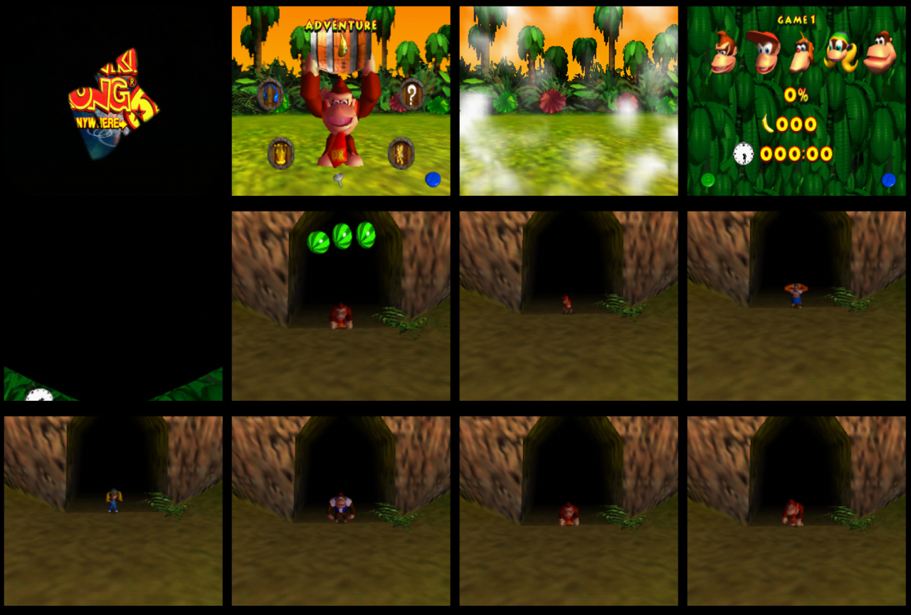

# Donkey Kong 64 – Tag Anywhere V5 · PAL port (Europe En,Fr,De,Es)

Port of Isotarge's **Tag Anywhere V5** patch (https://github.com/Isotarge/dk64-tag-anywhere) to the European ROM.
Same source code as the USA patch, rebuilt with the PAL addresses.

## Applying the patch

**Direct download:**
- [dk64-tag-anywhere-v5-pal.bps](https://github.com/xglacius/dk64-tag-anywhere-pal/raw/main/patches/dk64-tag-anywhere-v5-pal.bps) — for a `.z64` ROM (recommended; real hardware and emulators)
- [dk64-tag-anywhere-v5-pal-n64.bps](https://github.com/xglacius/dk64-tag-anywhere-pal/raw/main/patches/dk64-tag-anywhere-v5-pal-n64.bps) — for the No-Intro `.n64` ROM (emulators only)

Base ROM: **Donkey Kong 64 (Europe) (En,Fr,De,Es)**

| | |
|---|---|
| Base ROM SHA-1 (.z64) | `F96AF883845308106600D84E0618C1A066DC6676` |
| Base ROM CRC32 (.z64) | `A28C71C6` |
| Patched ROM SHA-1 (.z64) | `4EF26DD1CD74FFA9ACF9A2ACE6F4FFEE0B0E11E2` |

There are two patches, depending on your ROM's byte order (apply with Floating IPS, beat or https://www.marcrobledo.com/RomPatcher.js/):

| Patch | Base ROM | Base CRC32 | Output |
|---|---|---|---|
| `dk64-tag-anywhere-v5-pal.bps` | `.z64` (big-endian) | `A28C71C6` | `.z64` |
| `dk64-tag-anywhere-v5-pal-n64.bps` | `.n64` (byte-swapped, No-Intro) | `FC37B06A` | `.n64` |

Both produce exactly the same ROM; only the byte order differs.

> **Real hardware / flashcarts: use the `.z64`.** Tested on a PAL N64 with an **ED64 Plus**: the `.z64` ROM works perfectly, while the byte-swapped build (output of the `-n64` patch) gives a **black screen**.
> If your ROM is `.n64`/`.v64`, convert it to `.z64` first (RomPatcher.js or Tool64; the CRC32 must be `A28C71C6`) and apply `dk64-tag-anywhere-v5-pal.bps`.
> The `-n64` patch is meant for emulators, which accept any byte order.
>
> Note: even though the No-Intro ROM is named `.n64`, it is actually byte-swapped (it starts with `37 80 40 12`, which is normally `.v64`). A `.z64` starts with `80 37 12 40`.

As with the USA version: set the emulator save type to **EEPROM 16K**, and in BizHawk enable the Expansion Slot.

## Changelog
- **PAL 1.1** – Fixed a crash (game freezes on the debug crash screen) when tagging while a collision was pending, e.g. while touching or hitting an enemy. Tagging is now also denied during Strong Kong / Orangstand Sprint, Mini Monkey / Hunky Chunky and while touching an object (collectable, pad, switch). Checks ported from the DK64 Randomizer's Tag Anywhere. This crash also exists in the original USA V5 patch.
- **PAL 1.0** – First release.

## Controls and features
Same as the original: D-Pad Right or L = next kong, D-Pad Left = previous kong (DK → Diddy → Lanky → Tiny → Chunky).
The **SPEED MODE** option replaces STORY SKIP in the options menu (translated into all 4 languages: MODE VITESSE / SPEED-MODUS / MODO VELOCIDAD).

## PAL differences found (and fixed)
- All code and data addresses (~40) remapped via masked instruction signatures and cross-checked against dk64-practice-rom.
- **Temporary flags are +1** on PAL (the Speed Mode long boss intro flags: 104→105, etc.).
- **Kong swap action 0x3B → 0x3C** (the PAL action list has one extra entry). Without this, tagging does not change the kong.
- Different file indices: text (12/13 and 12/37, 4 languages each), textures (14/97, 14/179, 14/47).
- The custom code lives at ROM `0x1FF5000` (PAL data ends at `0x1FF4E7F`) and RAM `0x805D3E00` (heap lowered by 0x20000, as on USA).
- The global code patches (heap, Object Model 2) are applied from the boot hook instead of recompressing the code block, followed by a cache writeback/invalidate.

## Verification
Automated tests in mupen64plus (cached interpreter + angrylion software RDP):
- The ROM boots, shows the Tag Anywhere logos/title and reaches the main menu.
- Speed Mode: a new file starts directly in DK Isles with moves unlocked; D-Pad Right/Left/L cycle DK→Diddy→Lanky→Tiny→Chunky→DK and back, identical to the official USA patch in the same test.
- Normal mode: full intro, starts in DK's house, no tagging to locked kongs; patched instructions are restored to their original values.
- Speed Mode is remembered across resets.

Real hardware: tested on a PAL N64 with an ED64 Plus using the `.z64` ROM — works.

Not tested yet: in-game Golden Banana dance skip, Snide/K. Lumsy cutscene compression and faster Troff 'n' Scoff feeding.

## `build.py` diagnostic options
`--no-assets` (32 MB ROM, no text/logo changes), `--pad64` (pad to 64 MB) and `--no-cacheops` (no cache flush at boot). Not needed for normal use; added to isolate hardware issues.

## Building
Requirements: Python 3 + Pillow, `mips64-elf-gcc` and `armips` in PATH.

    python3 build.py --version pal --rom "DK64 (Europe).z64" --out rom/dk64-tag-anywhere-v5-pal.z64 --bps

`--version us` builds the USA version with the same pipeline.

## Credits
Original patch: Isotarge and the DK64 community (see `README_ORIGINAL_USA.md`).
